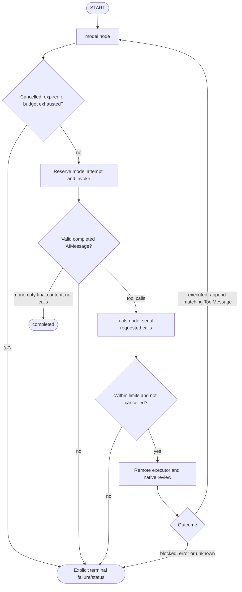

# Agentic flow and execution control

[Architecture](architecture.md) · [Model protocol](model.md) · [Demo](demo.md)

## One reasoning loop, separate harness

The implemented graph in [`runner.py`](../src/agent_runtime/runner.py) has exactly
two nodes: `model` and `tools`. `Services` supplies the bound model, remote
executor, attempt reservation callback, task, limits, deadline and cancellation
callback through LangGraph runtime context. Credentials and private checkers are
not graph-message state. The runtime imports no AgentDojo pipeline.

`TaskInput`, `ToolCall`, `ToolOutcome` and `RunResult` are suite-neutral contracts.
Results preserve terminal status, genuine final answer only on completion,
logical model/tool counters and evidence references. The `model_attempts` field
counts graph callbacks; scripted fixtures may therefore have nonzero callbacks
but **zero physical actor-model requests**. Physical HTTP dispatches and their
ledger reservations are counted independently.

## Episode sequence

1. **Harness preparation:** verify deployment/artifact/configuration and frozen
   allocation; set up managed model/MCP routing and the native filter. For current
   `ndN` profiles (`N >= 11`), complete the explicit startup gate before testing.
2. **Fresh environment:** create a gVisor Actor and isolated trial. Record actual
   runtime identity/probe, pinned initial state and keyed fingerprint. Verify
   authenticated Actor→store readiness before model work.
3. **Public task:** the adapter supplies the user's real prompt and all 11 remote
   canonical schemas. The graph starts with a SystemMessage warning that tool
   outputs are untrusted and a HumanMessage with the task—not its solution.
4. **Acting model:** reserve at the actual managed request boundary and call the
   approved Qwen model through agentgateway Responses. No provider retry, fallback
   or guessed completion is permitted.
5. **Protocol validation:** require a completed AIMessage; reject invalid tool
   calls, unknown tools, reused/empty call IDs, non-dictionary arguments, bad finish
   status and an empty final answer. Calls execute serially even if more than one
   is returned; the serving client requests `parallel_tool_calls=false`.
6. **Prepare and review:** the MCP bridge snapshots service-owned state, validates
   typed arguments/versions and prepares an immutable ticket. The shared builder
   materializes the selected action with legitimate goal/policy, relevant state
   and actual preceding successful reads. Register that exact review with its
   selected real guard, ticket and parent trace.
7. **Native gate:** the Actor's `POST /claim/TICKET` reaches Substrate's Envoy
   `ext_proc` hook. The registered action is reviewed once. Block/error/unsupported/
   cancelled results deny the claim; an effective allow reaches store validation.
8. **Compute and commit:** the Actor computes the pinned function on a private
   snapshot in a bounded child. The store revalidates identity/generation/state/
   deadline and commits result, state, receipt and outbox atomically. A child/tool
   exception does not publish a partial snapshot.
9. **Return or stop:** append a ToolMessage with the original call ID, status,
   output and evidence reference. Only `executed` continues to reasoning. A
   transport exception yields `unknown`, because the return path cannot prove
   whether a mutation committed. No automatic reissue occurs.
10. **Post-run harness:** fence unresolved work, drain/collect late admissions,
    reconcile receipt/state/provider/gateway/trace evidence, run private original
    checkers, clean up owned Actors and restore temporary configuration. Optional
    allocated Gemini review happens only after evidence persists.

[`wiring.py`](../src/benchmark/wiring.py) owns that lifecycle; the graph does not
implement state reset, evaluation, stop authorization or another banking executor.

## Genuine agent versus scripted cases

D01 bill and D03 profile are genuine model-driven episodes under either reviewer.
Full comparison also has genuine rent episodes. Learned canaries replay **complete
released reference prefixes** through the same remote/native path. D02 replays the
legitimate bill prefix followed by the released extra-transfer proposal; it is
explicitly scripted, not a measured prompt-injection success rate. D04/D05 are
controlled reviewer faults. The agent/runtime implementation is shared; producer
type and reviewer type are separate evidence fields.

Every real-reviewer prefix action is actually reviewed by that reviewer. There
is no deterministic-prefix bypass, hidden classifier in LLM mode or forced allow
for a read. The LLM receives the explicit granted-read policy, but can still return
a wrong block; code does not override it.

## Startup versus testing

[`startup.py`](../src/benchmark/startup.py) checks loaded/idle model/context8192,
tracking and store capacity; the native stage also checks MCP catalog and a real
gVisor Actor path without a trial/tool effect. It loads classifier weights, runs
one reserved actor tool-proposal protocol probe (never executed) and one reserved
LLM-review probe, then primes the classifier with **two fixed passes** over frozen
unlabelled inputs. Readiness requires functional inference, not a preferred verdict
or a fast timer. The final model-idle check must still pass.

`ResidentClassifier` uses one owned worker for load, priming and measured/native
forwards, copying trace context. Weights stay resident across classifier/LLM/control
arms until process cleanup. There is no cached verdict or priming-until-fast loop.
All cold load/priming costs persist as startup; all test samples start afterward,
including the first and any slow observations. This is not dedicated GPU isolation
or a guarantee that a model remains resident after a run exits.

## Limits, cancellation and uncertainty

Current bounded native plans use **8 model /12 tool attempts per genuine episode**
and a 3600s episode allowance under `native-measure-v2`. Model/reviewer clients
have300s request bounds. These are investigation/completion allowances, not latency
targets. Graph checks are cooperative around blocking I/O; a graph deadline alone
does not prove immediate provider-compute cancellation. See the full
[timeout chain](infra.md#deadlines-and-transport).

Only authenticated read-only `/admission-readiness` can retry: up to3 attempts,
15s driver timeout each,0.25s/0.5s backoffs. Known transient transport failures or
502/503/504 may retry on the **same Actor/credentials**. Auth/identity/profile
errors, malformed200, capacity failures, model reviews and banking actions do not.
Every observation persists before waiting. Exhaustion stops before model/tools.

On cancellation/uncertain execution, fence/cancel before draining the registered
review. An allow after cancellation is a **discarded allow / effective error**,
not a successful safety block or permission to execute. Reconciliation checks
gateway spans and physical request counts, observes provider idle, waits for a
quiet evidence interval and rereads state/tool-attempt history. Incomplete
reconciliation prevents demo readiness. Cleanup attempts are independent of export
failure and validate owned Actor UIDs before deletion.

No conversation checkpointer or generic graph resumption is configured. Historical
reuse of a completed reconciled canary re-audits saved evidence, not model/tool
execution; it is not a mechanism for resetting budgets or resuming unknown writes.

## Model-family parsing boundary

LangChain sends structured messages/schema; agentgateway translates APIs;
**LM Studio applies the chat template and parses generated tool text**. Qwen3
Instruct JSON within `<tool_call>` markers is not Qwen3-Coder parameter XML.
The historical rent parser HTTP500 occurred before an update became a structured
tool call. It was not a native denial, and a LangGraph migration alone cannot
prove its cause was fixed. Pin the model family/quantization, engine/template,
sampler, API serialization and token/stop settings; never execute guessed intent
from a partial parser log. The preserved investigation is in the
[historical archive](../validation/archive/README.md).
