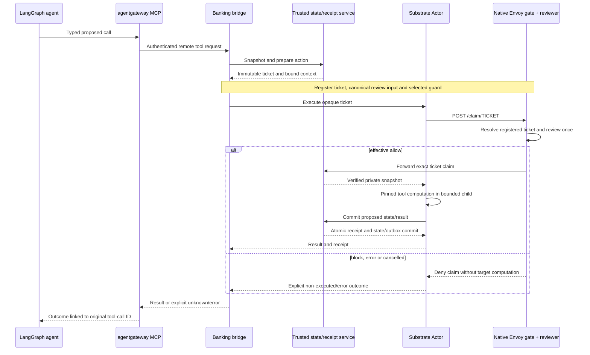

# System and evaluation-harness architecture

[Overview](../README.md) · [Agent flow](agent-flow.md) · [Model](model.md)
· [Validation](validation.md) · [Operations](infra.md)

## Scope and dependency direction

This is a local guard benchmark over synthetic AgentDojo banking. The supported
CLI entry point is `src.benchmark.demo`; the live web entry point is `src.demo_ui`.
Both orchestrate the existing `wiring.run_case`, not a new agent loop. One compiled agent proposes actions under either
reviewer. The LangGraph agent executes in the host-side Python harness, not inside
a Substrate Actor; pinned tool computation runs inside the Actor. Schema/state/
identity controls and private evaluation remain outside the agent loop.

| Layer / source | Owns | Must not do |
| --- | --- | --- |
| `integrations/agentdojo/banking.py` | Pinned suite loading, public task/schema adapter, private original checkers | Inherit the upstream agent pipeline or run live agent tools on the host |
| `agent_runtime/contracts.py`, `runner.py` | Neutral task/result contracts and LangGraph reasoning/tool loop | Depend on AgentDojo task IDs/checkers, choose guard backend or authorize tools |
| `benchmark/demo.py`, `wiring.py` | Case lifecycle, budgets, model/MCP wiring, Actor provisioning, evidence, scoring and cleanup | Supply hidden answers to prompts or invent missing execution evidence |
| `benchmark/bridge.py`, `native.py` | Prepare/register one action, resolve its ticket and invoke one authoritative reviewer at native admission | Trust an agent score or mismatch reviewed versus consumed actions |
| `banking_service/` | Compute pinned tools inside Actors; enforce trusted transaction and durable receipt/outbox semantics | Fall back to host execution or treat an uncertain return as non-execution |
| MLflow and post-run review | Trace/score readback, original checkers, explicit derived reports and scoped Gemini review | Participate in admission or overwrite negative historical findings |

The agent runtime is suite-neutral at the import/interface boundary. Root project
dependencies are still broad; fully reduced distributable dependency roles and
installed CLI packaging remain [#10](https://github.com/caldeirav/sub15-breaker/issues/10).
There is no `src/harness/` package or plugin framework to configure.

## Why both Agent Substrate and agentgateway?

**[Agent Substrate](https://github.com/agent-substrate/substrate)** owns execution:
ephemeral Actors, worker assignment, sandboxing, platform identity, lifecycle and
its Envoy egress dataplane. The benchmark attaches the release's experimental
additional egress `ext_proc` filter before an Actor claims a tool-action ticket.
This is the actual pre-execution enforcement boundary; an agent-local `if` or
HTTP error alone is not equivalent evidence.

**[agentgateway](https://github.com/agentgateway/agentgateway)** owns managed
connectivity: Responses/model routing, MCP discovery/calls, authentication policies,
backend/route timeouts and distributed telemetry. The deployed Kubernetes
controller-managed dataplane matters, not an unrelated standalone host binary.
It is **not** Substrate's Envoy gate and does not replace gVisor or the state store.

Both the local-model route and banking MCP route attach to the same managed
Gateway, `breaker-gateway`, on its `http` listener. They are separate backends and
routes, not separate gateway deployments. Acting and LLM-reviewer clients use that
same gateway endpoint; the local classifier executes directly in the host process.

Model requests enter as Responses and are explicitly translated to the configured
Completions upstream. LM Studio still applies the model-family chat template and
parses generated tool envelopes. MCP traffic goes to a bounded host bridge, which
delegates execution to the real Actor/store; it is not a host banking executor.
The tested MCP revision is `2026-07-28` sessionless discovery; separately tested
`2025-11-25` compatibility is not interchangeable with that protocol.

## Ticket binding and deterministic controls

The pinned native hook receives headers, not the proposed JSON body. The design
therefore gates **`POST /claim/<32-hex-ticket>`**. A trusted bridge registers the
service-prepared immutable ticket with its review input. The store consumes that
same path ticket and rejects a decoy body ticket; the old generic claim route is
not admitted by this benchmark hook. Unknown, duplicate and replayed registry
references fail closed. Unsupported projection never calls a model for approval.

Actions bind tool/typed arguments, action/idempotency IDs, principal/trial, Actor
UID/generation, expected state/context versions, policy/input versions and expiry.
Agent JSON cannot select its authority, policy, risk or deadline. The store
atomically revalidates freshness and one in-flight mutation rather than relying on
an earlier snapshot. Only the selected actual reviewer runs; the agent does not
score first and cause a second classification at the gateway.

`banking_contracts/` provides strict versioned DTOs, bounded unique-key JSON,
canonical UTF-8, schemas and explicit adapters. `banking-actions-v1` is the family;
the proposal version is `banking-action-v1`. Unknown versions/fields, malformed
UTF-8, nonfinite values and excessive sizes reject. JSON Schema cannot establish
authentication or arbitrary cross-field equality, freshness and cryptographic
binding; those remain runtime obligations.

Amounts are **exact decimal strings in benchmark-native units**. No currency is
inferred or rounding introduced. Conversion to AgentDojo's float parameters is
explicit and rejects decimal round-trip value loss; it is not exact binary-decimal
accounting. Record-only contract fixtures have `executed=false` even on allow;
they must not be confused with the Actor service's real synthetic executions.

## Authority, isolation and transactional effects

- **Untrusted:** model proposals, self-reported identity/risk, file/tool text and
  attacker-controlled observations. Trace headers correlate evidence, not authority.
- **Service-controlled:** authenticated ownership, Actor identity/generation,
  legitimate request/policy, current state, immutable tickets and committed receipts.
- **Evaluator-only:** reference solutions, checker code/results, attack goals,
  labels and split/candidate provenance. They do not become model features.
- **Outside the threat claim:** compromised host/control plane, cluster admin,
  trusted artifact publisher or policy authority.

Driver requests use scoped Kubernetes JWTs; Actor/store callbacks use injected
Substrate Actor JWTs with configured issuer/audience/subject/UID checks and trusted
verification keys. Operator bootstrap credentials never enter agent prompts.
The local cluster's HTTP segment is a trusted research transport assumption,
not an end-to-end encrypted production service or a general IAM system.

Tools execute in gVisor Actors, UID/GID10001, no effective capabilities after
startup, `no_new_privs`, no ambient Kubernetes token and bounded resources.
The entrypoint makes only its private root traversable before dropping privilege;
it does not recursively change host/shared permissions. Runtime proof correlates
actual assignment, worker/Actor UIDs, gVisor logs and the in-sandbox probe; an image
`USER` or WorkerPool setting alone is not proof.

**State lives outside disposable Actors:** one SQLite service with WAL/FULL sync,
owned PVC and key atomically publishes synthetic state, receipt and evidence
outbox. Actor computation is a proposed transition until that commit. Identical
completed replay returns the existing receipt; changed-payload ID reuse rejects.
Crash-before-commit can remain unknown; lost response after commit is resolved
from status/receipt without repeating the write. This is not distributed exactly-once
tool invocation, HA, backup or VM/node/disk-loss recovery.

Reset uses fresh synthetic state and a new Actor/generation; old tickets are
invalidated, while receipts/history remain. The default benchmark store has
capacity limits and exclusive durable campaign reservations. Repeatable-demo mode
removes retained trial/action caps and releases prior reservations without deleting
history or changing used counts. Outbox exhaustion/persistence failure blocks new work; export failure stays
pending and prevents complete-evidence acceptance.

## Failure and observability design

Denial prevents this claim; fencing/latching prevents later work; acknowledged
Actor deletion/stop is independently checked. None rolls back a prior effect or
disclosure. Cancel/fence precedes bounded drain; a late allow is recorded as a
discarded decision and cannot release a new mutation. Unknown writes are never
scored as prevented.

MLflow receives application traces and direct gateway OTLP/HTTP exports with W3C
parentage; Substrate's bundled Jaeger/debug collector is not silently relabelled
the MLflow path. Exact attempts, actions, receipt/state effects, scalar score
ownership and late remote spans are reconciled before claiming completeness.
See [trace contracts and acceptance](validation.md#trace-and-score-ownership).

## Deliberate non-goals and compatibility boundaries

No real payments, generic shell executor, multi-agent hierarchy, production HA,
new IAM or rollback engine is implemented. The optional two-hour soak remains
incomplete (#39); functional readiness is not a sustained-uptime qualification.
The saved-review API remains read-only. The separate [live demo UI](demo.md#live-web-interface--end-to-end)
uses an authenticated loopback Run endpoint, fresh automatic IDs on every click and one
worker owning the shared hook/bridge. Two lanes are displayed side by side but
execute sequentially on the single Qwen server. Opening/selecting/reconnecting
does not dispatch; only an explicit idempotent Run POST can do so. No generic
command/path input or browser infrastructure/provider credentials are accepted.
Cards can be repeated without allocations or budgets; each result/failure remains
separate and read-only, and Gemini provider charges still apply.

Historical `LocalBankingPipeline`, `ActorBankingTrial`, `src.agent.graph`, the
command-only sidecar/dataset/raw-SDK grader/Streamlit dashboard and placeholder
`k8s/` manifests are not the supported banking experiment. Shared checker,
calibration and judge utilities are intentionally reused where applicable.
In particular, legacy `src.feasibility.runner --oracle-only` **still calls Gemini**;
it is not a no-judge or offline mode. Frozen historical protocols and attestations
are in the [archive](../validation/archive/README.md), not current run instructions.
